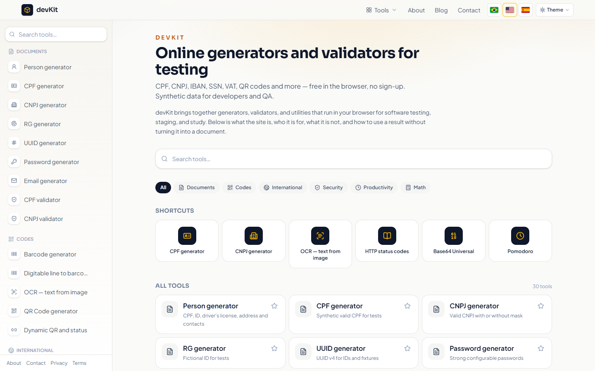
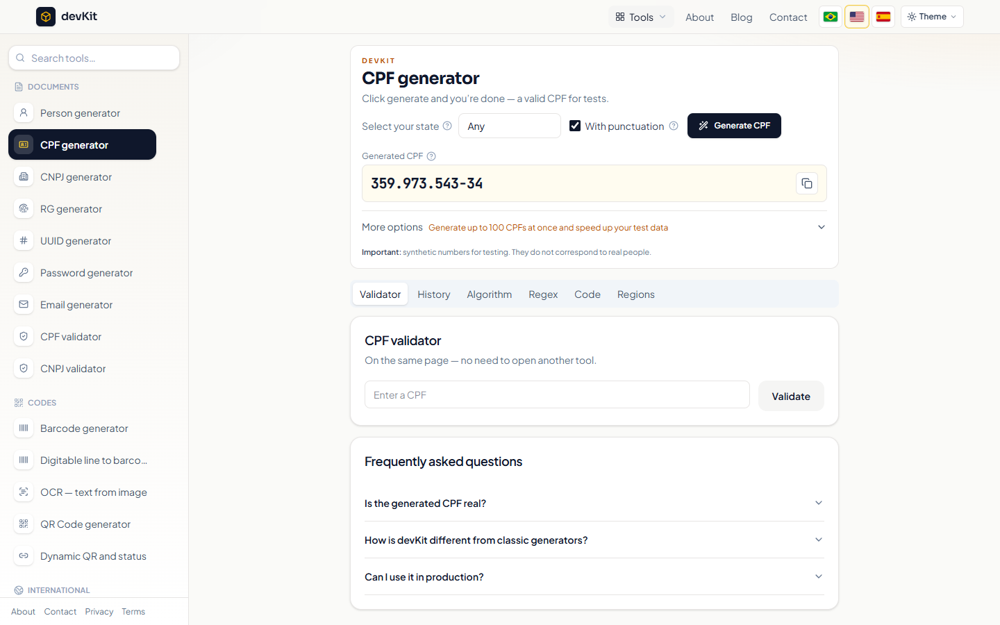
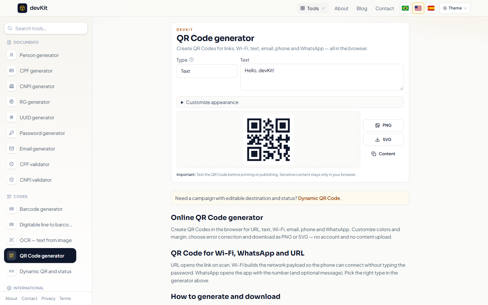
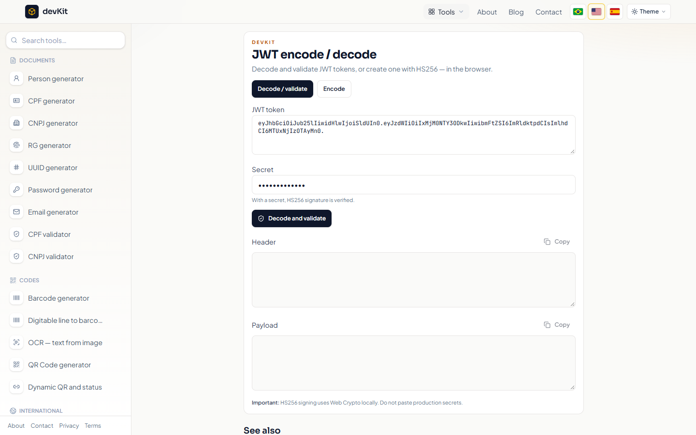

<div align="center">

# 🧰 devKit

**Ferramentas gratuitas e open source para desenvolvedores, que rodam 100% no navegador.**

Gere dados de teste, valide documentos, codifique/decodifique, formate JSON, crie QR Codes e muito mais — sem cadastro, sem rastreamento por padrão, nada enviado a servidor.

[](LICENSE)
[](https://nextjs.org)
[](https://www.typescriptlang.org)
[](CONTRIBUTING.md)
[](https://github.com/orlandoneto/devkit/stargazers)

[English](README.md) · [Português](README.pt-BR.md)

</div>

---



## ✨ Por que o devKit?

- **Privado por padrão** – geração e validação acontecem no seu navegador.
- **Mais de 30 ferramentas** organizadas por categoria, com histórico e cópia em um clique.
- **Multilíngue** – português, inglês e espanhol.
- **Modo escuro**, layout responsivo.
- **API REST** para os principais geradores (`/api/v1/*`, OpenAPI em `/api/openapi`).
- **Nenhuma configuração obrigatória** – analytics, anúncios, login e contato são opcionais e vêm desligados.

## 🛠️ Ferramentas

| Categoria | Ferramentas |
|---|---|
| **Dados de teste** | Gerador de pessoa, gerador e validador de CPF e CNPJ, gerador de RG |
| **Geradores** | UUID, senhas fortes, e-mails para teste |
| **Códigos** | Código de barras, linha digitável de boleto, QR Code (URL, Wi-Fi, WhatsApp…), QR Code dinâmico, OCR (imagem/PDF para texto) |
| **Internacional** | IBAN, SSN (EUA) e VAT (UE) |
| **Dev e segurança** | cURL no navegador, formatador de JSON, Base64 (texto e arquivo), JWT (decodificar, validar, assinar HS256), códigos HTTP, metadados EXIF de imagem |
| **Produtividade** | Pomodoro com sons |
| **Matemática** | Números romanos, fatoração, MDC, MMC, regra de 3, resto da divisão |

## 📸 Telas

| Gerador de CPF | QR Code | JWT |
|---|---|---|
|  |  |  |

## 🚀 Como rodar

Requisitos: **Node.js 20+** e npm.

```bash
git clone https://github.com/orlandoneto/devkit.git
cd devkit
npm install
npm run dev        # http://localhost:3000
```

Build de produção: `npm run build && npm start`.

As configurações opcionais estão em [`.env.example`](.env.example). Copie para `.env.local` e preencha só o que precisar.

## ➕ Como adicionar uma ferramenta

1. Lógica pura em `src/lib/<ferramenta>/index.ts` (com testes, se possível).
2. Interface em `src/components/<ferramenta>/`.
3. Página em `src/app/[locale]/<ferramenta>/page.tsx`.
4. Registre em `src/lib/tools.ts` (e `src/lib/home.ts`).
5. Textos em `messages/pt.json`, `en.json` e `es.json`.
6. Rode `npm run lint && npm run build` e abra um PR.

Veja o [CONTRIBUTING.md](CONTRIBUTING.md).

## 🤝 Contribuindo

Toda contribuição é bem-vinda: novas ferramentas, traduções, correções e documentação. Leia o [CONTRIBUTING.md](CONTRIBUTING.md) e o [Código de Conduta](CODE_OF_CONDUCT.md). Para falhas de segurança, veja o [SECURITY.md](SECURITY.md).

Se o devKit te ajudou, **deixe uma ⭐** — isso ajuda muito o projeto a crescer.

## 📄 Licença

O devKit usa a **[GNU General Public License v3.0](LICENSE)** (GPL-3.0-only).

Em palavras simples — a mesma ideia do Linux:

- ✅ Você pode **usar** de graça, para qualquer fim, inclusive comercial.
- ✅ Pode **estudar e modificar** o código.
- ✅ Pode **compartilhar** cópias.
- ⚠️ Se **distribuir** uma versão modificada, ela tem que continuar **GPL-3.0**, com o **código-fonte publicado** e os avisos de autoria e licença mantidos.

## 👤 Autor

Criado e mantido por **José Orlando Neto** — [@orlandoneto](https://github.com/orlandoneto).

Copyright © 2026 José Orlando Neto.
